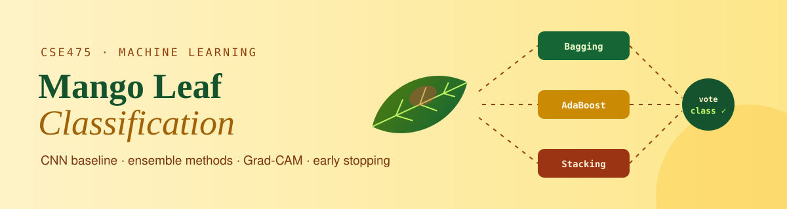

  

# 🍃 CSE475 · Machine Learning

Coursework for **CSE475 (Machine Learning)**.

## Assignment 01: Bangladeshi Mango Leaf Classification

Classifies mango leaf images (healthy and diseased) with a baseline **CNN**, then compares three **ensemble methods**:

- 🧩 **Bagging**
- 🚀 **Boosting** (AdaBoost)
- 🏗️ **Stacking**

Predictions are explained with **Grad-CAM** heatmaps. Every experiment runs twice, with and without early stopping, to compare the effect.

| Notebook | Description |
|---|---|
| [With early stopping](Assignment%2001/Bangladeshi_Mango_Leaf_Classification_with_Ensemble_Methods_With_ES.ipynb) | Training with early stopping on validation loss |
| [Without early stopping](Assignment%2001/Bangladeshi_Mango_Leaf_Classification_with_Ensemble_Methods_Without_ES.ipynb) | Training for the full number of epochs |

👉 For the full report with accuracy curves, confusion matrices and Grad-CAM samples, see [`Assignment 01/Readme.md`](Assignment%2001/Readme.md).

## Run

Open the notebooks in Jupyter or Google Colab (a GPU is recommended). They use PyTorch, torchvision, scikit-learn, NumPy and Matplotlib.
